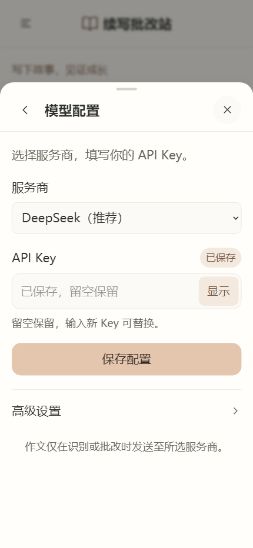

# 续写批改站 · Android

面向高考英语读后续写训练的开源批改工具。支持拍照与相册识别、作文评分、分类反馈、润色参考，以及 PDF、长图和作文备份导出。使用者自行配置模型服务与 API Key。

An open-source Android app for Gaokao English continuation-writing practice, with photo OCR, scoring, feedback, revision suggestions, report export, and configurable model APIs.

**当前版本：0.1.8 · Android 7.0+ · AGPL v3**

## 安装

从 [Releases](https://github.com/c4Ps080601/Gaokao_essay_grader_Android/releases) 下载 `essay-grader-0.1.8-release.apk`，按手机提示允许安装。

已有 0.1.3–0.1.7 正式签名版本可覆盖更新；旧调试版签名不同，请先导出作文备份再迁移。第三方自行构建的 APK 使用自己的签名，通常不能覆盖官方签名版本。

## 功能

- 系统拍照或相册添加，最多四张图片；拍照方向校正，重新编码时去除原始 EXIF 信息。
- OCR 后保留文字草稿，逐字核对后再提交；25 分制评分、四维分析与原稿保留。
- 区分确定错误、待核实问题、表达提升建议、亮点及润色参考。
- 本机多用户资料、自动保存、浅色/深色主题、四档字号与侧栏导航。
- PDF 自动分页、长图导出、系统文件保存/分享、JSON 作文备份导入导出。
- 提交后通过 Android 前台任务服务保护常规后台批改；网络结果不确定时不自动重发，减少重复收费风险。
- 服务商预设和自定义兼容接口；系统密钥库加密保存 Key，主动点击“显示”才临时解密显示。

## 开始使用

1. 输入本机用户名，打开设置 → 模型配置，选择服务商并保存自己的 Key。
2. 服务商、接口地址和模型需与你的账户一致；识别模型必须支持图片，文字测试成功不代表可以识别图片。
3. 录入题目、给定开头及续写，也可拍照识别；核对识别中的疑点、拼写和标点。
4. 提交批改，可切换应用等待；允许任务通知，不要强制停止或清理应用。
5. 查看反馈，导出报告或备份作文。

预设只提供接口配置，不包含 API 额度或密钥。模型调用、连接测试以及模型输出修复均可能产生服务商费用。本机用户名用于资料分组，**不是云端账号或安全身份认证**；本机不同用户名共用模型配置，教师入口为“教师”。

## 构建与项目结构

```text
app/frontend/   React 界面、本机 API 与模型运行时
app/android/    Capacitor Android 工程和原生插件
app/           共用批改规则、模型协议、桌面端及测试
scripts/       Windows Android 工具安装、构建和签名
```

需要 Node.js 22.12+、npm、JDK 21 和 Android SDK（compile/target API 36）。已验证的 Windows 构建步骤：

```powershell
python scripts/setup-android.py
cd app
npm ci
npm run check:ui
npm test
npm run android:build
```

默认生成本机调试签名 APK。发布签名构建可在仓库根目录执行：

```powershell
powershell -NoProfile -ExecutionPolicy Bypass -File scripts/build-android.ps1 -Release
```

首次发布构建会在本机生成自己的签名私钥，密码通过当前 Windows 账户 DPAPI 保护。私钥与密码文件不在仓库中；不要删除本机签名目录，迁移设备前妥善备份。具体见 [构建说明](docs/BUILD.md)。桌面基线代码保留在 `app/`，本仓库主要交付 Android 版。

## 隐私与验证边界

公开源码及 APK 不含开发者个人资料、真实 Key、用户作文、运行数据库、签名私钥、会话截图或构建日志。使用者录入的作文或照片只在主动识别/批改时发送到所配置的服务商；API Key 也会发送给对应服务商完成认证。备份不含密钥。[隐私与权限说明](docs/PRIVACY.md)

77 项自动化测试、类型检查、release 构建与 Lint、签名验证、32 项桌面界面回归及模拟 Android 桥的媒体/设置测试通过。**不代表已完成所有品牌手机和所有模型服务的真机、真实账户验证。** 强行停止、厂商极端省电、系统/渲染进程被结束仍可能中断；重启不会自动重复收费恢复。

AI 反馈用于学习辅助，不是官方阅卷结论，分数不等同于真实考试成绩。

## 界面预览

以下为模拟手机尺寸预览，使用示例资料：



## 许可

遵循 [GNU AGPL v3](LICENSE)，保留上游版权和许可证声明。修改、分发和网络提供服务时请遵守许可证要求。
